# Kirpitch — Requirements

**Status:** living draft, open to feedback through [GitHub issues](https://github.com/cocan-dev/kirpitch/issues) · **Last updated:** 6 November 2026 · **Maintainer:** Niky Cocan

This document describes what Kirpitch should do and how it is built. It is part of the Kirpitch project and licensed under GPL-3.0-or-later. Facts that change over time (KiCad versions, model recommendations) are marked "as of November 2026".

## Contents

- [Overview](#overview)
- [Inputs](#inputs)
- [Outputs](#outputs)
- [Pipeline](#pipeline)
- [Cross-checks](#cross-checks)
- [Tech stack](#tech-stack)
- [Model configuration](#model-configuration)
- [No-LLM mode](#no-llm-mode)
- [Interfaces](#interfaces)
- [Library](#library)
- [KiCad versions](#kicad-versions)
- [KiCad library integration](#kicad-library-integration)
- [Quality requirements](#quality-requirements)
- [Scope and milestones](#scope-and-milestones)
- [Roadmap after v1](#roadmap-after-v1)

## Overview

Kirpitch turns a datasheet for an electronic component or a mechanical connector into a ready-to-use KiCad library part. It is written in Rust and ships as one fast local binary with a command-line interface (CLI) and a desktop app.

The name comes from *chirpici*, the Romanian clay bricks once used to build simple homes: raw clay (the datasheet) is shaped into standard bricks (parts) that build a house (the library). It is spelled Kirpitch so English speakers say it close to the Romanian ("KIR-pitch"), and it hides two KiCad nods: the *Ki* prefix of KiCad tools, and *pitch*, the spacing between pins.

**Goals**

- Datasheet in, finished KiCad part out (symbol, footprint, 3D model, and a SPICE simulation model where possible) in under 2 minutes for a typical IC (integrated circuit). SPICE = Simulation Program with Integrated Circuit Emphasis.
- No silent guessing: every extracted value records the datasheet page it came from and how confident the extraction was, and the user approves each stage (pinout, footprint, 3D model, SPICE model) before the next one is built.
- Output loads cleanly in KiCad and follows the KLC (KiCad Library Conventions).
- Local-first: works with any LLM (large language model) the user has, whether cloud, hosted or local, or with none at all (no-LLM mode).

## Inputs

- **PDF (Portable Document Format) datasheets**, either text-based or scanned. Scanned pages go through OCR (optical character recognition).
- **Mechanical drawings** for connectors. These are often image-only dimensioned drawings, so they need a vision-capable model.
- **Optional extras:** a manufacturer STEP model (STEP = Standard for the Exchange of Product model data, the usual 3D CAD (computer-aided design) format), or an existing KiCad part to update.
- **Later:** a URL, or an MPN (manufacturer part number) that Kirpitch uses to fetch the datasheet itself.

## Outputs

| Output | KiCad file | Requirements |
| --- | --- | --- |
| Symbol | `.kicad_sym` | Pin numbers, names and electrical types; pins grouped by function; multi-unit for large parts |
| Footprint | `.kicad_mod` in a `.pretty` folder | Pads from the datasheet's recommended land pattern; if there is none, calculate it from package dimensions using IPC-7351 (the IPC standard for land patterns); courtyard, silkscreen, fab layer, pin-1 marker |
| 3D model | `.step` + `.wrl` | Parametric model built from package dimensions; use the manufacturer's model when one is supplied; aligned to the footprint origin |
| Simulation model | `.lib` / `.sub` (SPICE) | Only when the datasheet gives a model or enough parameters (diodes, MOSFETs, op-amp macro models); linked through KiCad's `Sim.*` fields |
| Metadata | Symbol fields | MPN, manufacturer, datasheet URL, description, keywords, package |
| Report | `.json` + `.md` | Every value with its source page and confidence, plus all assumptions made |
| Packaging | Library tables, PCM zip | Entries for `sym-lib-table` / `fp-lib-table`; optional PCM (KiCad Plugin and Content Manager) package |

MOSFET = metal-oxide-semiconductor field-effect transistor.

## Pipeline

Kirpitch stops for the user's approval after every stage, and nothing downstream is built until the stage before it is approved. The LLM only reads the datasheet; plain, deterministic Rust code builds every output from one shared **PartSpec**.

```mermaid
flowchart LR
    A["Datasheet<br/>PDF, text or scanned<br/>+ optional STEP"] --> B["Extract<br/>any LLM, or manual"]
    B --> C["PartSpec<br/>one JSON spec,<br/>edited at each gate"]
    C --> G1{{"Gate 1: Pinout<br/>pin names, types<br/>symbol preview"}}
    G1 -- approve --> G2{{"Gate 2: Footprint<br/>pads, pitch, pin 1<br/>over the drawing"}}
    G2 -- approve --> G3{{"Gate 3: 3D model<br/>body, leads, height<br/>on the footprint"}}
    G3 -- approve --> G4{{"Gate 4: SPICE model<br/>params + test sim<br/>skip if none"}}
    G4 -- approve --> E{{"Export<br/>KLC + kicad-cli<br/>then write library"}}
```



Gates (hexagons) are where the user checks and approves before Kirpitch continues. At each gate: approve, edit any value, re-extract just that stage, or skip it. Editing an approved stage re-opens every stage after it.

The PartSpec is a versioned JSON (JavaScript Object Notation) document holding pins, package dimensions, land pattern, 3D body, electrical parameters and metadata. Each value carries `{page, bbox, confidence}`, where bbox (bounding box) is the region on the page it was read from. Low-confidence values are highlighted at their gate.

**Review gates**

| Gate | What the user checks | How the app shows it |
| --- | --- | --- |
| 1. Pinout | Pin numbers, names, electrical types, units, grouping, alternate functions | Pin table beside the datasheet's pinout page, each row linked to its source; live symbol preview; bulk edit |
| 2. Footprint | Package dimensions, pad size, pitch and positions, pin 1, courtyard, silkscreen, paste and mask | Footprint drawn over the datasheet's land-pattern drawing at the same scale; dimension labels; measuring tool; pad table in mm |
| 3. 3D model | Body size and height, lead shape, pin-1 marking, alignment to pads | 3D view sitting on the footprint; top, side and front views; switch to the manufacturer's STEP model if one exists |
| 4. SPICE model | Model type, parameters, pin-to-node mapping | Parameter table; a quick test simulation plotted with ngspice (the open-source SPICE engine KiCad uses) |
| Export | KLC report, kicad-cli load test, list of files to write | Checklist; nothing is written to the user's library before this gate |

**Gate rules**

- At each gate the user can approve, edit any value, re-run extraction for that stage only (optionally with a hint such as "pinout is on page 4"), or skip the stage (for example, no SPICE model).
- Editing an approved stage re-opens every later stage that depends on it. For example, changing the pin count re-opens footprint, 3D model and SPICE model.
- Approvals are saved in the PartSpec, so work can stop and resume at any gate.
- Validation errors point to the exact field and gate to fix, never to the generated files.

## Cross-checks

Kirpitch runs automatic checks at every gate, whether values came from an LLM or were typed in by hand. A failed **error** blocks approval. A **warning** can be overridden with a short note, and the note is saved in the PartSpec.

| Check | Gate | Rule | Level |
| --- | --- | --- | --- |
| Pin count | 1. Pinout | Symbol pins = package pin count, exposed pad included | Error |
| Unique pin numbers | 1. Pinout | No duplicate pin numbers; repeated names only for power and ground, stacked | Error |
| Power pins | 1. Pinout | Every supply pin has a power type; at least one ground pin | Warning |
| Tolerance order | 2. Footprint | min ≤ nom ≤ max for every dimension | Error |
| Pitch fit | 2. Footprint | (pins per side − 1) × pitch fits inside the body length | Error |
| Pin ↔ pad match | 2. Footprint | Every pin number has a pad and every pad has a pin, unless marked mechanical or not connected | Error |
| Two sources agree | 2. Footprint | When the datasheet gives both package dimensions and a recommended land pattern, the IPC-7351 result and the recommended pattern agree within tolerance | Warning |
| Pad clearance | 2. Footprint | Pad-to-pad gap ≥ the user's PCB (printed circuit board) maker minimum, set in a fab profile | Error |
| Pin 1 | 2 and 3 | Pin 1 is in the same place on the pinout drawing, footprint and 3D model | Error |
| 3D fit | 3. 3D model | Leads land on their pads; body sits inside the courtyard; height ≤ the datasheet maximum | Error |
| SPICE nodes | 4. SPICE | Model node count and order match the symbol pins | Error |
| Units | All | All values stored in mm; values given in inches or mils (thousandths of an inch) are converted and flagged | Warning |
| Second read | All (optional) | A second extraction pass, or a second model, re-reads critical values (pitch, pad size, pin count); any disagreement is flagged | Warning |

## Tech stack

Kirpitch is written in **Rust**, chosen over Go because it gives a single static binary, strong types for geometry and units, the Tauri framework for a light desktop app, and better options for PDF rendering and 3D CAD output.

**License:** GPL-3.0-or-later (GNU General Public License, version 3 or later), the same family as KiCad. Parts that users generate with Kirpitch belong to them; the license covers Kirpitch's code, not its output. Code: [github.com/cocan-dev/kirpitch](https://github.com/cocan-dev/kirpitch). Planned crate name `kirpitch` on crates.io and website kirpitch.dev. Contacts: hello@cocan.dev, and security@cocan.dev for security issues.

- **Structure:** a Cargo workspace (Cargo = Rust's build tool). Crates: `kirpitch-core` (PartSpec schema and validation), `kirpitch-extract`, `kirpitch-gen-symbol`, `kirpitch-gen-footprint`, `kirpitch-gen-3d`, `kirpitch-gen-spice`, `kirpitch-cli`, `kirpitch-app`.
- **PDF and OCR:** candidates are `pdfium-render` for page rendering and text with positions, and `ocrs` or Tesseract for scans. Check that each library is still actively maintained before adopting it.
- **LLM backends:** any provider the user has, or none, behind one Rust trait (see Model configuration). Every response is structured JSON checked against the PartSpec schema.
- **KiCad files:** write the S-expression formats (KiCad's bracketed text format) with our own serializer, with one writer per supported KiCad version (see KiCad versions).
- **3D models:** evaluate `truck` and `opencascade-rs` for STEP output. If neither is good enough, fall back to a bundled CadQuery (Python CAD library) sidecar, which is what KiCad's official 3D generators use.
- **Validation:** call `kicad-cli` (KiCad's command-line tool) to load-test files and export SVG (Scalable Vector Graphics) previews.
- **Schema:** `serde` + `schemars`, so the PartSpec JSON schema is generated from the Rust types.

## Model configuration

Kirpitch works with whatever model the user has: a cloud API (application programming interface), a hosted service, a local runtime, or no model at all. Kirpitch ships recommended presets, but every setting can be overridden.

| Kind | Examples | How Kirpitch connects |
| --- | --- | --- |
| Cloud APIs | Anthropic, OpenAI, Google Gemini, Mistral (EU-hosted) | Native adapter per provider |
| Enterprise clouds | Azure OpenAI, AWS Bedrock, Google Vertex AI | Native adapter per provider |
| Hosted open models | Ollama Cloud, OpenRouter | Ollama native API at `ollama.com` (key in `OLLAMA_API_KEY`); OpenRouter via OpenAI-compatible API |
| Local runtimes | Ollama, LM Studio, llama.cpp server, vLLM, LocalAI | Ollama native API, or OpenAI-compatible API on a custom base URL |
| Anything else | Any server that speaks the OpenAI chat API | Generic `openai-compatible` adapter with a custom base URL |

**Requirements**

- **Per-task routing:** separate models for text tables, drawings (vision) and metadata. For example, a local model for pinouts and a cloud model only for connector drawings.
- **Capability probe:** `kirpitch models test` checks each configured model for vision, structured JSON output and context size. Kirpitch then picks the best way to get valid JSON (JSON schema → tool calling → prompt plus automatic repair).
- **Secrets:** API keys come from environment variables or the OS (operating system) keychain, never from the config file.
- **Privacy switch:** `local_only = true` refuses any endpoint that isn't on the machine or the LAN (local area network). The app shows, per task, whether data leaves the machine.
- **Cost and time:** each run shows tokens used, time taken and, for cloud models, estimated cost.
- **Fallback:** if a model fails or isn't configured, that stage drops to no-LLM mode instead of stopping.
- **Rust client:** evaluate the unified-client crates `siumai`, `llm` and `multi-llm`. If none fits, write a thin trait with our own adapters.

Example `kirpitch.toml` (TOML = Tom's Obvious Minimal Language, a simple config format):

```toml
[models.local-vision]
provider = "ollama"
base_url = "http://localhost:11434"
model = "qwen3-vl:7b"

[models.cloud-best]
provider = "anthropic"
model = "claude-sonnet"        # resolved to the current version
api_key_env = "ANTHROPIC_API_KEY"

[tasks]
pin_tables = "local-vision"
drawings   = "cloud-best"
metadata   = "local-vision"

[privacy]
local_only = false
```

**Recommended setups (starting point, as of November 2026)**

| Setup | Recommended | Why |
| --- | --- | --- |
| Best accuracy | A current frontier vision model: Claude Sonnet or Opus, Gemini Pro, GPT-5.x | Frontier cloud models and specialised document models rank at the top of public document-AI benchmarks such as the [IDP Leaderboard](https://idp-leaderboard.org) (OCR, table extraction, key information extraction); use its Open Source filter to compare local options |
| Local, 12–16 GB GPU | Qwen3-VL 7B (Q4/Q5 quantized) on Ollama or llama.cpp | Good at reading text and pin tables; weaker on dimension drawings |
| Local, 24 GB+ GPU or 32 GB+ Apple Silicon | Qwen3-VL 32B | Higher quality, still fully local |
| Mixed (default) | Local model for pin tables and metadata, cloud model only for drawings | Most data stays local; accuracy where it matters most |
| No GPU, no cloud | No-LLM mode | Fully manual, still fast thanks to templates and cross-checks |

GPU = graphics processing unit. These are starting points. `kirpitch bench` runs the golden test set against any configured model and reports accuracy per gate. Each Kirpitch release publishes a measured recommendations table, so users choose from data rather than claims.

## No-LLM mode

Kirpitch is fully usable without any model. Only the Extract step changes; the gates, generators and cross-checks stay the same.

- **Region pick:** the user draws a box on a datasheet page and labels it: pin table, dimension table, or drawing.
- **Table parsing:** text-based PDFs are parsed from text positions using column detection. Scanned pages are run through OCR first, then parsed the same way.
- **Package templates:** the user picks a package family (SOIC, QFN, SOT, DIP, pin header, and so on) and fills in its standard dimension letters (A, A1, b, D, E, e, L). A reference drawing shows what each letter means. These letters follow JEDEC (Joint Electron Device Engineering Council) package standards, which most datasheets use. Package names used here: SOIC = small-outline IC, QFN = quad flat no-lead, TSSOP = thin shrink small-outline package, SOT = small-outline transistor, DIP = dual in-line package.
- **Paste and import:** pin tables can be pasted from the clipboard or imported from CSV (comma-separated values).
- **Mix per gate:** the LLM can be switched on or off for each gate. For example, LLM for the pinout and manual entry for the footprint.
- **Same traceability:** values picked by hand also record their page and region, so cross-checks and review work exactly as in LLM mode.

## Interfaces

- **Desktop app (main interface):** a local app built with Tauri. The screens use web technology (HTML, JavaScript) shown in the operating system's built-in web view, but it is not a website: no server, no account, and files stay on the machine. It runs the review gates described in Pipeline.
- **Local web mode:** `kirpitch serve` serves the same interface on `localhost` (or the LAN), so it can run on a home server or another machine and be used from a browser.
- **CLI:** `kirpitch build datasheet.pdf` runs extraction and stops at Gate 1. Then `kirpitch review --stage pinout|footprint|3d|spice` shows that stage's values and opens them in `$EDITOR`, and `kirpitch approve --stage <name>` unlocks the next stage. Add `--yes` to approve everything without prompts (batch runs only).
- **Library:** `kirpitch-core` and the generators can be used as a Rust crate (library) on their own.
- **Later:** a KiCad plugin that uses KiCad's IPC API (inter-process communication interface, KiCad 9+) to start Kirpitch from inside the editor.

## Library

Every part Kirpitch builds goes into one personal library that can be edited at any time. It is single-user for now; shared libraries come later.

- **Layout:** one folder, kept under git (the version-control tool). Each part has its own subfolder with its PartSpec (the source of truth), the datasheet PDF or its URL plus hash, its check report and its generated files. Kirpitch assembles the KiCad libraries from all the parts: one `.kicad_sym`, one `.pretty` folder and one `.3dshapes` folder.
- **Edit later:** opening a part returns to any gate. Changing a value regenerates that stage and re-opens the stages after it.
- **Rebuild all:** `kirpitch rebuild --all` regenerates every part after a Kirpitch update, a style change (line widths, fab profile) or a new KiCad target. It shows a diff and writes only after approval.
- **History:** every change is a git commit, with a visual before/after view of the symbol, footprint and 3D model.
- **Browse and search:** by MPN (manufacturer part number), manufacturer, package and tags. Kirpitch warns about duplicates and reuses one footprint when several parts share a package.
- **New datasheet revision:** drop in the new PDF; Kirpitch re-extracts it and shows only the values that changed.
- **Later:** shared or team libraries, and importing hand-made KiCad parts as partial PartSpecs.

## KiCad versions

The PartSpec does not depend on any KiCad version; only the file writers do. So one part can be written for any supported KiCad version at any time.

The constraint: KiCad major releases almost always change file formats. Newer versions open older files, but once a file is saved in a new major version, older versions can no longer open it ([KiCad 10 docs](https://docs.kicad.org/10.0/en/introduction/introduction.html)). As of November 2026, KiCad 10 is the current major release; it came out in March 2026, and 10.0.6 shipped in August ([KiCad 10.0.6 release](https://www.kicad.org/blog/2026/08/KiCad-10.0.6-Release/)).

- **Supported targets:** always the latest three major versions, which as of November 2026 means KiCad 8, 9 and 10. When a new major version ships, the oldest one is dropped. Each supported version gets its own writer and its own KLC (KiCad Library Conventions) rule set.
- **Default target:** the version of the installed KiCad, read from `kicad-cli version`. If none is found, the latest stable version.
- **Choosing the target:** set it per library in `kirpitch.toml` (`kicad_target = "9"`), or regenerate the whole library for another version with `kirpitch rebuild --all --target 9`.
- **Oldest wins for compatibility:** writing the older format is the safe choice when files will be opened in several versions, because newer KiCad reads it and upgrades it when saving.
- **Feature gating:** features that only newer versions have, such as embedded files, are used only when the target supports them. Anything dropped for an older target appears as a warning in the report.
- **Never downgrade by conversion:** KiCad has `fp upgrade` and `sym upgrade` commands but no downgrade. Older formats are always written fresh from the PartSpec.
- **Testing:** CI (continuous integration) runs a container with each supported KiCad version and load-tests every golden part in that version's `kicad-cli`. A nightly job also runs against KiCad development builds, to catch format changes before the next major release.

## KiCad library integration

Kirpitch works alongside KiCad's own libraries instead of duplicating them.

- **Reuse official parts first:** before generating a footprint or 3D model, Kirpitch looks in the official KiCad libraries for an exact package match (for example `SOIC-8_3.9x4.9mm_P1.27mm`). At Gate 2 and Gate 3 it shows the official footprint or model next to the computed one, with any differences highlighted, and the user picks one. Reusing an official part links to it instead of copying it.
- **KiCad naming:** generated footprints and 3D models follow KiCad's naming rules, so they sit naturally next to official parts and are easy to match later.
- **HTTP library:** `kirpitch serve` also exposes the library as a KiCad HTTP (HyperText Transfer Protocol) library (KiCad 8+). KiCad's symbol chooser can then browse Kirpitch parts live, with MPN, manufacturer, datasheet and description fields. KiCad HTTP libraries are read-only and carry only part data that points to symbol and footprint files ([KiCad dev docs](https://dev-docs.kicad.org/en/apis-and-binding/http-libraries)), so the files still live in the library folder.
- **Later:** show a vendor's footprint (SnapMagic, Ultra Librarian, LCSC) at Gate 2 as a third comparison.

## Quality requirements

- **Deterministic:** the same PartSpec always produces byte-identical files. Generation from a PartSpec takes under 1 second.
- **Consistency checks:** every rule in Cross-checks runs at its gate, and all of them run again before export.
- **KLC compliance:** port the checks from KiCad's `kicad-library-utils`, or call them directly. Every generated part must also load in `kicad-cli` without errors.
- **Caching:** extraction results are cached per PDF hash, so re-running never calls the LLM twice for the same file.
- **Privacy:** nothing leaves the machine unless the user picks a cloud LLM. No telemetry.
- **Platforms:** Linux, macOS, Windows.
- **Tests:** a golden set of about 30 datasheets (SOIC, QFN, TSSOP, SOT-23, DIP, through-hole parts, USB-C, JST (a Japanese connector brand), pin headers), each with a hand-checked expected PartSpec, plus snapshot tests for every generator.

## Scope and milestones

The MVP (minimum viable product) covers text-based PDFs and standard IC packages (SOIC, SOT, QFN, TSSOP, DIP). It outputs a symbol, footprint and parametric 3D model, with review done through the CLI.

1. **PartSpec + generators:** schema and all generators, driven by hand-written PartSpecs. No LLM yet.
2. **Extraction:** no-LLM mode (region pick, package templates), then LLM extraction of pinouts and package dimensions for ICs through any configured provider. Includes source tracing, cross-checks and `kirpitch bench`.
3. **Desktop review app:** the Tauri app with side-by-side review and live previews, plus the library browser with history and diffs.
4. **Connectors:** extraction from dimensioned drawings, and connector 3D models.
5. **Extras:** SPICE models, fetching by MPN, PCM packaging, and the KiCad plugin.

**Out of scope for now:** fitting SPICE models from datasheet curves, BGA (ball grid array) parts with more than 256 balls, and placing parts into schematics.

**Open questions**

- Default local model for extraction?
- Distributor APIs for MPN lookup: Mouser, DigiKey or LCSC (a Chinese electronics distributor)?
- How long should Kirpitch warn before dropping the oldest KiCad target?

## Roadmap after v1

**v2 (version 2)**

- **All package variants in one pass:** one datasheet often covers several packages (for example an STM32 in LQFP-48 and QFN-48, where LQFP = low-profile quad flat package). Kirpitch builds all of them from one shared pinout gate.
- **BOM in, missing parts out:** import a BOM (bill of materials), find the parts not yet in the library, fetch their datasheets and queue them for the gates.
- **Vendor 3D auto-alignment:** detect and fix the offset and rotation of a vendor STEP model so it sits correctly on the footprint, then confirm it at Gate 3.
- **Match your style:** learn pin length, text size and layout from parts already in the library, so new symbols look like the existing ones.
- **MCP server:** expose Kirpitch as MCP (Model Context Protocol) tools so AI agents such as Claude Code can create parts. Every gate still needs the user's approval.

**Backlog**

- **Fab profiles:** presets for JLCPCB, PCBWay and Aisler (minimum clearances, paste settings), used by the cross-checks.
- **Exposed-pad helpers:** paste split into smaller windows and thermal vias under exposed pads.
- **IPC-7351 density levels:** most, nominal and least land patterns, plus hand-solder variants.
- **Assembly fields:** LCSC/JLC part numbers and pick-and-place rotation offsets.
- **Swappable pins:** mark interchangeable pins and units for KiCad 10's pin and gate swap.
- **Learn from fixes:** corrections made at the gates become local test data for `kirpitch bench` and help tune prompts.
- **Typical-application blocks (experimental):** turn a datasheet's reference circuit into a KiCad design block.
- **Other EDA formats:** Altium and Eagle writers built from the same PartSpec. EDA = electronic design automation.
